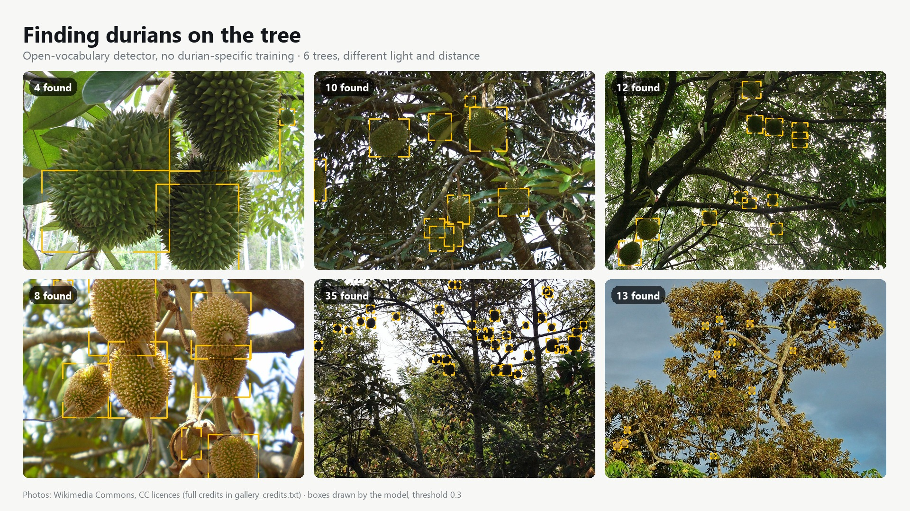
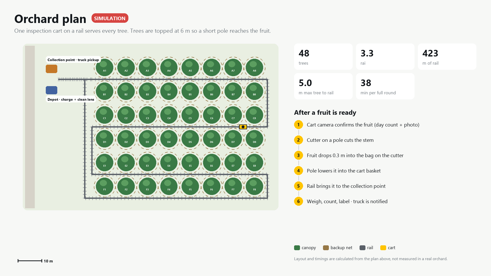
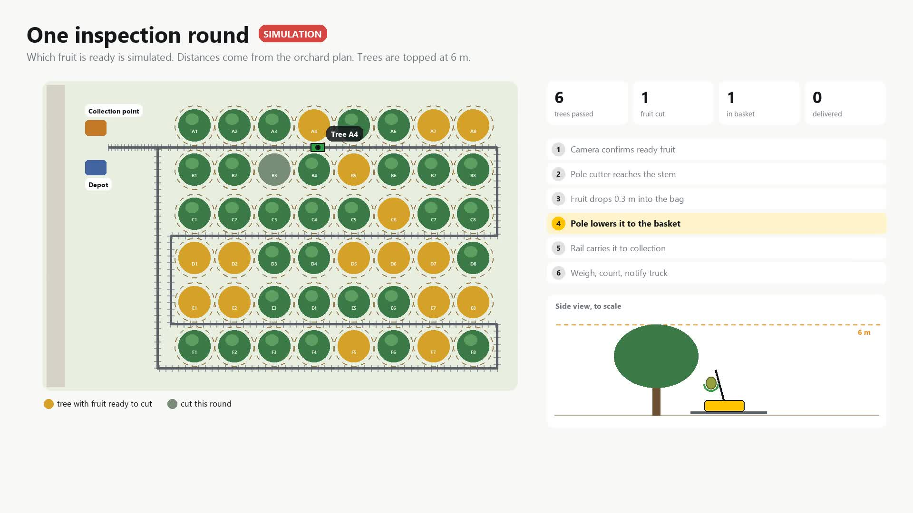
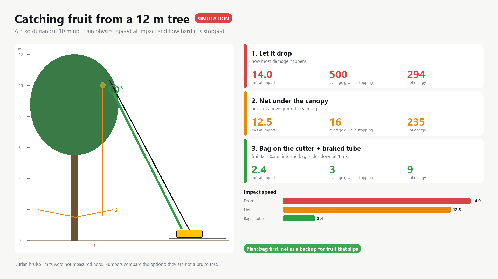
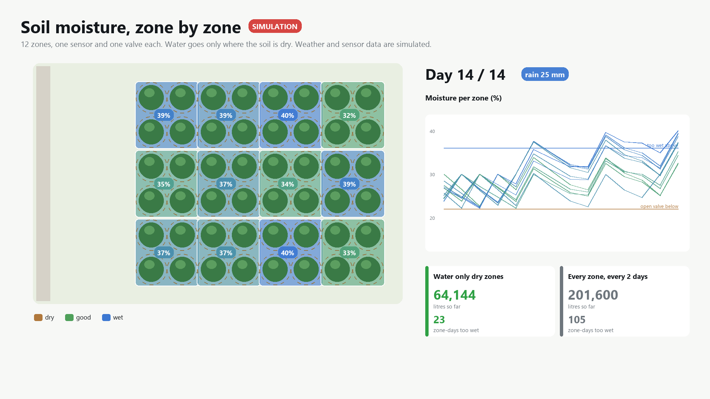

# Durian Orchard Monitor

Spotting durians on the tree with a camera, following each fruit as the camera moves,
and working out how a small orchard could be harvested with one machine on a rail.



## Why

Durian growers lose money when fruit is cut too early, and nobody can remember which fruit
set on which day across hundreds of trees. Harvesting is also dangerous: someone climbs
10 metres up and lowers each fruit on a rope.

The long-term idea is one inspection cart that runs on a rail past every tree, a pole cutter,
nets that catch the fruit, and one collection point. This repo is the software side, plus
a simulation of the rest so the idea can be checked on paper first.

## What works today

**Finding fruit, no training.** An open-vocabulary detector (OWLv2) finds durians from the text
prompt "a durian fruit". The gallery above is six Wikimedia Commons photos: close up, far away,
against the sky, and young fruit. A cleanup step removes the usual duplicate boxes (a box on part
of a fruit, or one box spanning two fruits).

**One id per fruit while the camera moves.** Handheld video breaks naive tracking: every time
the camera pans, the same fruit gets a new number, and panning looks like falling. The tracker
estimates camera motion from the background (ORB features + RANSAC) and matches fruit in
camera-compensated coordinates. On a test clip of a farmer harvesting, it follows one fruit
from the branch all the way down the rope and reports it once as "lowered from the tree".

**Honest limits.** Very close to the fruit, near and far things move differently and the motion
estimate breaks down, so the running count over-counts. A camera on a rail cart moves along a
straight line at a steady distance, which is exactly the case where this works, and is one more
reason for the rail design.

Ripeness is **not** guessed from skin colour. I tried it: mature durians are still green,
and it mislabelled most fruit. The plan is to count days from flowering instead (Monthong is
about 120 days).

## The orchard, simulated



A 48-tree plot (8 x 6, 9 m by 10 m spacing, about 3.3 rai). The rail runs down every second
alley, so one pass serves the row on each side:

- 423 m of rail, no tree more than 5 m from it, never through a canopy (checked in tests)
- At 0.5 m/s with a 30 s camera stop per tree, one full round takes about 38 minutes



[`docs/sim_round_en.mp4`](docs/sim_round_en.mp4) plays one round: the cart stops at trees with
ready fruit, the pole cutter cuts the stem, the fruit drops into the net and rolls into the
basket, and at the end the collection point weighs, counts and notifies the truck.
**Which fruit is ready is random in the simulation.** Distances and timings come from the plan.

## More of the orchard, simulated

**Catching fruit from a 12 m tree.** Plain kinematics for a 3 kg durian cut 10 m up: dropped, it hits
the ground at 14 m/s; a net 2 m up still meets it at 12.5 m/s; a bag on the cutter head catches it after
0.3 m (2.4 m/s), then a braked tube lowers it. The plan is bag first, net as a backup.



**Soil moisture by zone.** 12 zones with one sensor and one valve each, 14 simulated days with rain.
Watering only the zones that are dry used 68% less water than watering every zone every two days, and
had far fewer waterlogged zone-days (23 vs 105), which matters because durian roots rot in standing
water. Weather and sensor values are simulated.



## Run it

Python 3.10+. A GPU helps (about 2.7 s per image on a GTX 1650, much slower on CPU).

```bash
pip install -r requirements.txt
python -m pytest

python -m scripts.fetch_commons                      # CC photos from Wikimedia Commons
python -m scripts.photo_gallery                      # out/gallery.jpg + credits

python -m scripts.video_demo analyse my_tree.mp4     # slow: detection + camera motion, cached
python -m scripts.video_demo render my_tree.mp4 en   # fast: annotated clip (en or th)

python -m scripts.sim_plan en                        # orchard plan
python -m scripts.sim_video en                       # one simulated round
python -m scripts.sim_catch en                       # catch options, to scale
python -m scripts.sim_irrigation en                  # 14 days of zone watering
```

## Layout

```
durian/
  detector.py   OWLv2 wrapper + duplicate-box cleanup
  motion.py     camera motion between frames
  tracker.py    one id per fruit, lowered-fruit events
  layout.py     orchard grid and rail route, in metres
  plan_draw.py  top-down drawing
  render.py     shared drawing style
scripts/        command-line entry points
tests/
```

## Next

1. Real footage from one tree, filmed the same way every week, to test counting against a hand count
2. A small durian-specific model, fast enough for a live camera
3. Flowering dates per tree and a weekly "ready to cut" list

## Credits

Gallery photos are from Wikimedia Commons under CC BY / CC BY-SA licences. Authors and links
are in [`docs/gallery_credits.txt`](docs/gallery_credits.txt). The gallery image is shared under
CC BY-SA 4.0 for that reason.

Aphisit Aoonu · [LinkedIn](https://www.linkedin.com/in/aphisit-aoonu/)
